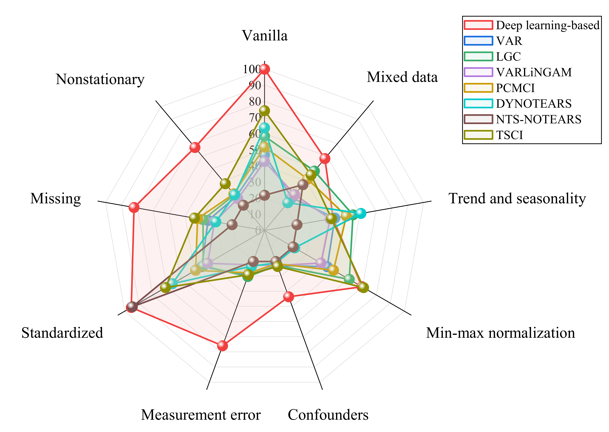

.. |ProjectPage| image:: https://img.shields.io/badge/Project-Page-brightgreen
   :target: https://huiyang-yi.github.io/CausalCompass/

.. |arXiv| image:: https://img.shields.io/badge/arXiv-2602.07915-b31b1b.svg
   :target: https://arxiv.org/abs/2602.07915

.. |Documentation| image:: https://img.shields.io/badge/View-Documentation-blue
   :target: https://causalcompass.readthedocs.io/en/latest/index.html

.. |Datasets| image:: https://img.shields.io/badge/Datasets-Kaggle-20BEFF
   :target: https://www.kaggle.com/datasets/anonymousauthors/assumption-violation-datasets/data

.. |PyPI| image:: https://img.shields.io/pypi/v/causalcompass
   :target: https://pypi.org/project/causalcompass/

.. |GitHub| image:: https://img.shields.io/badge/GitHub-CausalCompass-black?logo=github
   :target: https://github.com/huiyang-yi/CausalCompass

.. |License| image:: https://img.shields.io/badge/License-MIT-yellow.svg
   :target: https://github.com/huiyang-yi/CausalCompass/blob/main/LICENSE

|ProjectPage| |arXiv| |Documentation| |Datasets| |PyPI| |GitHub| |License|

==============
CausalCompass
==============

**CausalCompass** is a Python package that provides a flexible and extensible benchmark framework for evaluating the robustness of **time-series causal discovery (TSCD)** methods under **misspecified modeling assumptions**. For more details, please refer to the `Document <https://causalcompass.readthedocs.io/>`_.

Abstract
^^^^^^^^

Causal discovery from time series is a fundamental task in machine learning. However, its widespread adoption is hindered by a reliance on untestable causal assumptions and by the lack of robustness-oriented evaluation in existing benchmarks. To address these challenges, we propose CausalCompass, a flexible and extensible benchmark framework designed to assess the robustness of time-series causal discovery (TSCD) methods under violations of modeling assumptions. To demonstrate the practical utility of CausalCompass, we conduct extensive benchmarking of representative TSCD algorithms across eight assumption-violation scenarios. Our experimental results indicate that no single method consistently attains optimal performance across all settings. Nevertheless, in most scenarios, the methods exhibiting superior overall performance are deep learning-based approaches. We further provide hyperparameter sensitivity analyses to deepen the understanding of these findings. We additionally conduct ablation experiments to explain the strong performance of deep learning-based methods under assumption violations. We also find that NTS-NOTEARS relies on standardized preprocessing in practice, performing poorly in the vanilla setting but exhibiting strong performance after standardization. Finally, our work aims to provide a comprehensive and systematic evaluation of TSCD methods under assumption violations, thereby facilitating their broader adoption in real-world applications. The user-friendly implementation, documentation and datasets are available at https://github.com/huiyang-yi/CausalCompass.

Key Features
^^^^^^^^^^^^

* **8 assumption-violation scenarios**: Confounders, nonstationarity, measurement error, standardization, missing data, mixed data, min-max normalization, and trend/seasonality
* **2 vanilla models**: VAR (linear) and Lorenz-96 (nonlinear)
* **11 TSCD algorithms spanning 6 major methodological categories**:

  * **Granger causality-based**: VAR, LGC
  * **Constraint-based**: PCMCI
  * **Noise-based**: VARLiNGAM
  * **Score-based**: DYNOTEARS, NTS-NOTEARS
  * **Topology-based**: TSCI
  * **Deep learning-based**: cMLP, cLSTM, CUTS, CUTS+

Datasets
^^^^^^^^

The benchmark datasets are available on
`Kaggle <https://www.kaggle.com/datasets/anonymousauthors/assumption-violation-datasets/data>`_.
Dataset-generation functions are provided in ``causalcompass/datasets/``.

The generated datasets follow the naming convention::

   [scenario]_[params]_[model]_p[p]_T[T]_[optional]_seed[seed].npz

Example: ``confounder_rho0.5_VAR_p10_T1000_seed0.npz``

Citation
^^^^^^^^

If you use this code or datasets in your research, please cite:

.. code-block:: bibtex

   @inproceedings{yi2026causalcompass,
     title = {{CausalCompass}: Evaluating the Robustness of Time-Series Causal Discovery in Misspecified Scenarios},
     author = {Yi, Huiyang and Shen, Xiaojian and Wu, Yonggang and Chen, Duxin and Wang, He and Yu, Wenwu},
     booktitle = {Advances in Neural Information Processing Systems},
     year = {2026},
     url = {https://arxiv.org/abs/2602.07915}
   }

License
^^^^^^^

* The code in this repository is released under the `MIT License <https://github.com/huiyang-yi/CausalCompass/blob/main/LICENSE>`_.
* The datasets generated and provided by this repository are released under the `CC BY 4.0 License <https://github.com/huiyang-yi/CausalCompass/blob/main/LICENSE-CC-BY-4.0>`_.

Contributing
^^^^^^^^^^^^

Contributions are welcome! If you encounter bugs, have suggestions for improvements, or would like to extend CausalCompass with additional assumption-violation scenarios or evaluation protocols, please feel free to open an issue or submit a pull request. 

Contact
^^^^^^^

For questions or issues, please:

* Open an issue in this repository
* Email: yihuiyang@seu.edu.cn
